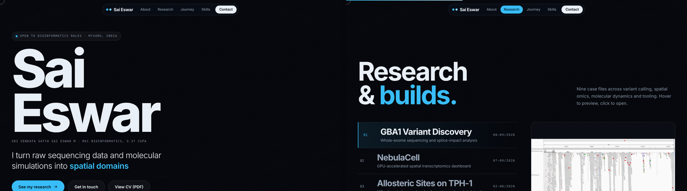

  

`> YOUR WORLD, MY RULES.`

 

&nbsp;

&nbsp;

 

 

Variant calling · Spatial omics · Molecular dynamics · Python · linux · WES · CLI Tools 

 

**MSc Bioinformatics** student working at the crossroads of structural biology and computation. My research is centred on understanding how proteins move, communicate, and malfunction decoded through molecular dynamics simulations, network-based analysis, and structural characterisation.

I try to build end-to-end computational workflows: from GROMACS trajectory analysis to graph-theoretic models of allosteric communication, with a growing focus on applying ML to structural data.

**Research focus**
- Conformational exploration · Gromacs · Schrodinger (Desmond)  
- Enhanced sampling methods · metadynamics · PLUMED · MixMD
- Protein residue interaction networks · allosteric communication
- Machine learning in structural biology

**Open to** research collaborations, bioinformatics tool development, MD simulation projects, and open-source scientific software.

 

<table>
<tr>
<td valign="top" width="50%">

**Languages & Core**

</td>
<td valign="top" width="50%">

**Molecular Simulation**

</td>
</tr>
<tr>
<td valign="top">

**Structural Biology**

</td>
<td valign="top">

**Network & Advanced Analysis**

</td>
</tr>
<tr>
<td valign="top">

**Bioinformatics & Databases**

</td>
<td valign="top">

**Machine Learning & Data**

</td>
</tr>
</table>

When the simulations are queued — CODM (ranked, and it's a problem 🎮), films across every genre, and research papers I read voluntarily. The chaos is very intentional.

  

