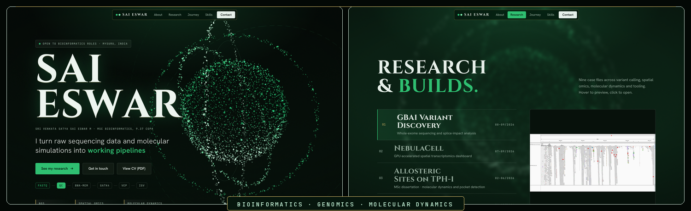

  

`> YOUR WORLD, MY RULES.`

&nbsp;

 

&nbsp;

&nbsp;

 

 

 

&nbsp;

&nbsp;

**MSc Bioinformatics** student working at the crossroads of structural biology and computation. My research is centred on understanding how proteins move, communicate, and malfunction decoded through molecular dynamics simulations, network-based analysis, and structural characterisation.

I try to build end-to-end computational workflows: from GROMACS trajectory analysis to graph-theoretic models of allosteric communication, with a growing focus on applying ML to structural data.

&nbsp;

<!-- RESEARCH INTERESTS -->

<h3>RESEARCH INTERESTS</h3>

<code>STRUCTURE</code> &nbsp;·&nbsp; <code>DYNAMICS</code> &nbsp;·&nbsp; <code>DISCOVERY</code>

### Molecular Dynamics & Pocketome Analysis

Investigating protein conformational dynamics, transient binding pockets, and cryptic sites through molecular dynamics simulations. Interested in understanding how protein flexibility influences ligand binding, druggability, and potential allosteric regulation.

### Residue Network Analysis & Structural Bioinformatics

Exploring residue-level interaction networks and long-range communication within proteins to identify allosteric pathways, structural dependencies, and the molecular mechanisms underlying protein function.

### Neuroinformatics

Interested in understanding the molecular and systems-level mechanisms underlying neural function and neurological disorders by integrating computational biology, systems-level analysis, and publicly available biological datasets.

### AI & Machine Learning in Bioinformatics

Applying machine learning and data-driven approaches to structural and molecular datasets to identify biological patterns, prioritise candidates, and generate testable hypotheses for computational research.

 

<!-- SKILLS & TOOLING -->

<strong>SKILLS &amp; TOOLING</strong>

 

<table>
<tr>
<td width="50%" valign="top">

<h3>LANGUAGES &amp; CORE</h3>

</td>
<td width="50%" valign="top">

<h3>MOLECULAR SIMULATION</h3>

</td>
</tr>
<tr>
<td width="50%" valign="top">

<h3>STRUCTURAL BIOINFORMATICS</h3>

</td>
<td width="50%" valign="top">

<h3>NETWORK &amp; ADVANCED ANALYSIS</h3>

</td>
</tr>
<tr>
<td width="50%" valign="top">

<h3>BIOINFORMATICS &amp; DATABASES</h3>

</td>
<td width="50%" valign="top">

<h3>MACHINE LEARNING &amp; DATA</h3>

</td>
</tr>
</table>

*Even the pursuit of scientific supremacy must occasionally pause for ranked warfare, cinematic indulgence, and the observation of lesser minds behaving predictably.*

 

